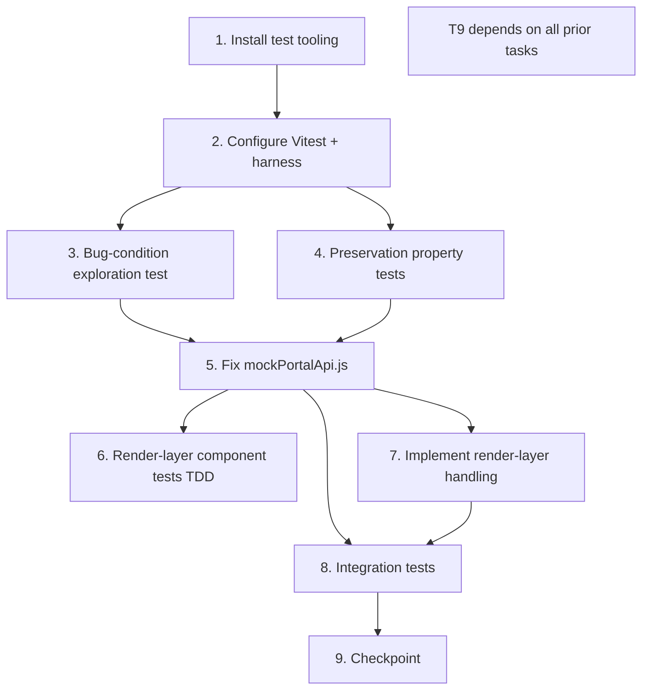

# Implementation Plan

## Overview

This plan follows the bug-condition methodology from `design.md`:

- **Property 1 (Bug Condition)**: a freshly registered (non-seeded) user must start empty — zero enrolled courses, zero per-user statistics, empty/placeholder identity, every course enrollable.
- **Property 2 (Preservation)**: every non-fresh input (seeded demo accounts, real enrollments, admin operations, aggregate analytics, profile edits, the real backend) is unchanged.

The four-phase bugfix sequence is the spine: **(A)** bug-condition exploration test → **(B)** preservation property tests → **(C)** implementation → **(D)** checkpoint. Tasks 1–2 (setup/infrastructure) enable writing those tests and are not part of the fix; tasks 6–7 (render-layer) and task 8 (integration) extend the fix and verification. Exploration and preservation tests are **standalone** and are placed **before** implementation, per the workflow.

Testing stack (repo currently has none): Vitest (natural fit for Vite/React) + `@testing-library/react` + `@testing-library/jest-dom` + `jsdom` + `fast-check` (property-based testing). The mock API is plain JS over a `localStorage`-backed DB, so core logic is unit-testable without a DOM; the empty-state handling is verified with React Testing Library.

> All commands are run from the `frontend/` directory. Use `--run` for single-execution test commands (never watch mode in automation).

## Tasks

### Phase 0 — Setup & Test Infrastructure

- [ ] 1. Install test tooling and add test scripts
  - Add devDependencies to `frontend/package.json`: `vitest`, `@testing-library/react`, `@testing-library/jest-dom`, `jsdom`, `fast-check`. Pin exact versions (e.g. `vitest@^2`, matching the Vite 6 / React 18 stack).
  - Add scripts: `"test": "vitest --run"` and `"test:watch": "vitest"` (watch is manual only).
  - Run `npm install` and confirm it succeeds.
  - Verify: `npm run test -- --passWithNoTests` exits 0 with no tests collected.

- [ ] 2. Configure Vitest and build the shared test harness
  - Create `frontend/vitest.config.js`: `environment: 'jsdom'`, `globals: true`, `setupFiles: ['./src/test/setup.js']`, `include: ['src/**/*.{test,spec}.{js,jsx}']`. (Vitest reads `import.meta.env` from the Vite config, so demo-mode env works out of the box.)
  - Create `frontend/src/test/setup.js`: import `@testing-library/jest-dom`; in `beforeEach` clear `localStorage` and call `demoApi.resetDemoData()` so every test starts from a clean seeded DB that carries the `isSeededDemo` markers; enable fake timers via `vi.useFakeTimers()` and expose a `flushDemoTimers()` helper that resolves the mock API's `delay()` (180 ms `window.setTimeout`) using `vi.advanceTimersByTimeAsync(200)`; optionally stub `crypto.randomUUID` to a deterministic counter for stable IDs.
  - Create `frontend/src/test/demoHarness.js`:
    - Helpers wrapping the async demo API with timer flushing: `registerFresh(payload)`, `loginDemo(role)`, `getProfileOf(token)`, `seededDb()`, `getCoursesList()`, `getAnalytics(token)`.
    - `fast-check` arbitraries: `fc Arb` for registration payloads (random name/email/role), seeded-user selectors, and course/enrollment/admin-CRUD mutation sequences.
    - A `goldenMaster(fn)` utility that runs `fn` on the unfixed code and records the deep-cloned output for preservation comparison.
  - Create `frontend/src/test/fixtures/expectedSeeded.js` to hold the observed seeded outputs captured in task 4 (filled in during the observation step).
  - Verify: a trivial sanity test (`expect(1).toBe(1)`) plus a `demoApi.getCourses()` call (with flushed timers) returns 6 courses; fake timers resolve the delay.

### Phase 1 — Bug-Condition Tests (write BEFORE the fix; expected to FAIL on unfixed code)

- [ ] 3. Write bug-condition exploration test
  - **Property 1: Bug Condition** - Fresh Accounts Start Empty
  - **CRITICAL**: write this test BEFORE implementing the fix. It MUST FAIL on unfixed code — failure confirms the bug exists. DO NOT fix the test or the code when it fails; this same test validates the fix once it passes after implementation.
  - **GOAL**: surface counterexamples that demonstrate the bug on the unfixed demo API.
  - **Scoped PBT approach**: use `fast-check` to generate random fresh registrations (random name/email/role) and assert the *expected (fixed)* behavior — `enrolledCourses.length === 0`, all stats `=== 0`, identity fields empty/placeholder, every course enrollable. On unfixed code these assertions fail, surfacing the bug across the input domain.
  - Concrete deterministic cases to assert and document as counterexamples:
    - Fresh student `register({ role: 'student' })` → currently `enrolledCourses` contains `course-cloud-120`, `learningHours = 14`, `attendance = 80`, `completionRate = 52`, non-empty `department`/`title`/`avatar`. (Defects 1.1, 1.3, 1.5, 1.6.)
    - Fresh admin `register({ role: 'admin' })` → currently `enrolledCourses` contains `course-mgmt-210`, `managedPrograms >= 3`, `satisfaction = 96`, non-empty identity. (Defects 1.2, 1.4, 1.5.)
    - Learning Spotlight leakage: the fresh student's `populateUser` output has `enrolledCourses[0]` resolving to the seeded Cloud Operations Lab (so the catalog would mark it "Already enrolled"). (Defects 1.6, 1.7.)
    - Zero-activity non-zero stats edge: force `courseCount = 0` through `createStudentProfile` (or a fresh user) → stats are still `14 / 80 / 52`, never zero, proving the non-zero baseline is the root cause. (Defect 1.3.)
    - Catalog enrollability: build `enrolledCourseIds` from a fresh student's populated `enrolledCourses` → currently it is non-empty, so at least one course is wrongly pre-marked enrolled. (Defect 1.7.)
  - Run on UNFIXED code. **EXPECTED OUTCOME**: test FAILS. Record the observed counterexamples (e.g. "fresh student gets `learningHours=14` instead of 0; `course-cloud-120` pre-enrolled").
  - Mark complete when the test is written, run on unfixed code, and the failure/counterexamples are documented.
  - _Requirements: 2.1, 2.2, 2.3, 2.4, 2.5, 2.6, 2.7_

- [ ] 4. Write preservation property tests (BEFORE implementing the fix, observation-first)
  - **Property 2: Preservation** - Non-Fresh Inputs Unchanged
  - **IMPORTANT**: follow the observation-first methodology. Observe behavior on UNFIXED code for seeded accounts and real operations, record the outputs (golden master), then write `fast-check` property tests asserting the fixed code reproduces them exactly.
  - Observe and record expected seeded outputs (write into `expectedSeeded.js`):
    - Seeded student `user-student-demo` (Aarav, 3 enrolled courses): `learningHours = 14 + 3*3 = 23`, `attendance = min(98, 80+3*4) = 92`, `completionRate = min(96, 52+3*12) = 88`, `enrolledCourses` = the 3 seeded course objects, identity = the seeded `department`/`title`/`phone`/`location`/`bio`/`avatar`.
    - Seeded admin `user-admin-demo` (Maya): `managedPrograms = Math.max(db.courses.length, 3)`, `satisfaction = 96`, `activeStudents = studentCount` (real aggregate), identity = seeded values.
  - Property-based tests (`fast-check`):
    - Seeded-student preservation: for each seeded student, `populateUser` deep-equals the golden master (courses, stats, identity identical).
    - Seeded-admin preservation: for the seeded admin, `populateUser` deep-equals the golden master.
    - Real-enrollment preservation: a seeded student enrolls in a new course → `enrolledCourses.length` increments and stats recompute via the gated formula; result deep-equals the same operation run through the captured original behavior.
    - Random seeded-user + mutation sequences: generate random course/enrollment mutations over seeded users and assert `populateUser_fixed` deep-equals the golden master at every step.
    - Aggregate-analytics preservation: `getAdminAnalytics` on a seeded-only DB is identical before/after (the function is untouched; totals/rosters come from real stored data).
    - Admin-CRUD preservation: create/update/delete/assign over a seeded admin leaves populated outputs and analytics identical to the observed original.
  - Non-PBT preservation checks:
    - Profile-edit preservation (3.5): `updateProfile` mutates only `name`/`email`/`password` and returns the same populated shape; persists across a `getProfile` re-fetch.
    - Backend cleanliness (3.6): static assertion that `backend/models/User.js` defaults `enrolledCourses` to `[]` and `backend/controllers/authController.js` `sanitizeUser` returns only real fields, and that these files are unchanged by this fix.
  - Run on UNFIXED code. **EXPECTED OUTCOME**: tests PASS (this is the baseline behavior to preserve).
  - Mark complete when tests are written, run on unfixed code, and passing.
  - _Requirements: 3.1, 3.2, 3.3, 3.4, 3.5, 3.6_

### Phase 2 — Implementation (the fix, scoped to the bug condition)

- [ ] 5. Fix `frontend/src/services/mockPortalApi.js` so fresh accounts start empty
  - [ ] 5.1 Implement the fix
    - **`seedUsers`**: add `isSeededDemo: true` to each of the four entries; keep existing identity fields and `enrolledCourses` unchanged. (`resetDemoData()` re-seeds from this array, so markers are restored on reset.)
    - **`register()`**: construct a minimal fresh user containing only `_id`, `name`, `email`, `password`, `role` (default `'student'`), `createdAt`, and `enrolledCourses: []`. Do NOT set `avatar`, `department`, `title`, `phone`, `location`, or `bio`. Do NOT set `isSeededDemo`.
    - **`createStudentProfile(user, courseCount)`**: identity fields use `user.<field> || ''`; gate stats by `user.isSeededDemo` — seeded keep the existing formula (`learningHours = 14 + courseCount*3`, `attendance = Math.min(98, 80 + courseCount*4)`, `completionRate = Math.min(96, 52 + courseCount*12)`); fresh get `learningHours = 0`, `attendance = 0`, `completionRate = 0`.
    - **`createAdminProfile(user, courseCount, studentCount)`**: identity fields use `user.<field> || ''`; gate `managedPrograms` and `satisfaction` by `user.isSeededDemo` — seeded keep `Math.max(courseCount, 3)` and `96`; fresh get `managedPrograms = 0`, `satisfaction = 0`. Keep `activeStudents = studentCount` for everyone (real aggregate, allowed by 2.4).
    - **`populateUser(user, db)`**: no logic change — keep the current shape (`avatar: user.avatar` passes through as `undefined` for fresh users; `enrolledCourses: courseList`; `...baseProfile`).
    - **Testability (optional, behavior-neutral)**: add named exports for `seedUsers`, `createStudentProfile`, `createAdminProfile`, and `populateUser` alongside the existing default `demoApi` export, so the design's direct unit tests can target them. Default import behavior is unchanged.
    - _Bug_Condition: `isBugCondition(result)` — `isFreshlyRegistered(sourceUser)` AND (`enrolledCourses.length > 0` OR any per-user stat `> 0` OR `hasPredefinedIdentity(result)`)_
    - _Expected_Behavior: for fresh users → `enrolledCourses = []`, `learningHours/attendance/completionRate = 0` (student) and `managedPrograms/satisfaction = 0` (admin), identity fields `''`/`undefined`, every course enrollable; aggregates still reflect real data_
    - _Preservation: seeded accounts keep seeded courses + stats; real enrollments update counts; admin CRUD works; aggregates computed from real data; profile edits persist; backend stays clean_
    - _Requirements: 2.1, 2.2, 2.3, 2.4, 2.5, 2.7, 3.1, 3.2, 3.3, 3.4, 3.5, 3.6_

  - [ ] 5.2 Verify the bug-condition exploration test now passes
    - **Property 1: Expected Behavior** - Fresh Accounts Start Empty
    - **IMPORTANT**: re-run the SAME test from task 3 — do NOT write a new test. The task-3 test encodes the expected behavior.
    - Run the bug-condition exploration test. **EXPECTED OUTCOME**: PASSES (confirms fresh accounts are zero/empty and all courses are enrollable).
    - _Requirements: 2.1, 2.2, 2.3, 2.4, 2.5, 2.6, 2.7_

  - [ ] 5.3 Verify preservation tests still pass
    - **Property 2: Preservation** - Non-Fresh Inputs Unchanged
    - **IMPORTANT**: re-run the SAME tests from task 4 — do NOT write new tests.
    - Run the preservation property tests. **EXPECTED OUTCOME**: PASSES (confirms no regressions for seeded accounts, real enrollments, admin ops, aggregates, profile edits, and the backend).
    - _Requirements: 3.1, 3.2, 3.3, 3.4, 3.5, 3.6_

### Phase 3 — Render-Layer Empty-State (frontend, render-only)

The mock now emits empty/zero/`undefined` for fresh accounts; the pages must render that gracefully. These changes only activate when a field is empty, so seeded accounts (which have real values) render exactly as before.

- [ ] 6. Write frontend empty-state component tests (TDD)
  - Test harness: mock `useAuth` (or wrap in a test `AuthProvider`) to supply a controlled `user`, and mock `services/api` where pages fetch data. Use `flushDemoTimers()` / `waitFor` for async effects.
  - `StudentDashboard` with a fresh user (`avatar: undefined`, `department: ''`, `title: ''`, `enrolledCourses: []`): assert the profile-highlight avatar `img` uses the placeholder avatar; snapshot Department and profile-highlight Location/Department show `'Not provided'`; Learning Spotlight shows neutral title/description copy and the category chip shows a neutral label; no broken `` (placeholder used as the final fallback).
  - `ProfilePage` with a fresh user: banner and avatar images use the placeholder; title, Department, Phone, and Location show `'Not provided'`; name/email/role/courses render their real values.
  - `AdminDashboard` roster with a fresh student (`avatar: undefined`): roster row avatar uses the placeholder; aggregate StatCards render real totals.
  - `CoursesPage` (student) with a fresh user: `enrolledCourseIds` is empty, so every `CourseCard` shows "Enroll now" (none "Already enrolled"); admin student-list avatars use the placeholder.
  - Preservation assertion within the same suite: render each page with a seeded user and confirm real avatar/identity/spotlight values still render (placeholders masked).
  - These tests FAIL before the render-layer changes in task 7 (the mock fix alone leaves broken images and empty strings). Mark complete when tests are written and failing as expected.
  - _Requirements: 2.5, 2.6, 2.7, 3.1_

- [ ] 7. Implement render-layer empty-state handling
  - Create `frontend/src/constants/placeholders.js` exporting `PLACEHOLDER_AVATAR` (an inline SVG data-URI silhouette — no network dependency) and `NOT_PROVIDED = 'Not provided'`. Import it in the four pages.
  - `StudentDashboard.jsx`:
    - Learning Spotlight hero image: `featuredCourse?.image || user?.avatar || PLACEHOLDER_AVATAR`.
    - Spotlight title/description fallbacks: neutral copy (e.g. title `"Your learning spotlight is ready"`, description `"Enroll in a course to feature it here."`) — does not imply seeded content.
    - First chip: `featuredCourse?.category || user?.department || 'Get started'`.
    - Student snapshot Department: `user?.department || NOT_PROVIDED`.
    - Profile highlights: avatar `user?.avatar || PLACEHOLDER_AVATAR`; Location and Department: `|| NOT_PROVIDED`.
  - `ProfilePage.jsx`: banner `user?.enrolledCourses?.[0]?.image || user?.avatar || PLACEHOLDER_AVATAR`; avatar `user?.avatar || PLACEHOLDER_AVATAR`; title `user?.title || NOT_PROVIDED`; Department, Phone, Location: `|| NOT_PROVIDED`.
  - `AdminDashboard.jsx`: roster row avatar `student.avatar || PLACEHOLDER_AVATAR`.
  - `CoursesPage.jsx`: admin student-list avatar `student.avatar || PLACEHOLDER_AVATAR`. (No change to `enrolledCourseIds` logic — it is already an empty `Set` for fresh users.)
  - **No changes** to: `StatCard`s (already use `|| 0`, so they render `0%`/`0h`), the "No courses enrolled yet" block (already handles `enrolledCourses.length === 0`), and `CoursesPage` enrollment detection.
  - _Expected_Behavior: empty identity renders placeholders; Learning Spotlight neutral when no courses_
  - _Preservation: seeded users have non-empty values so placeholders are masked and rendering is identical to before_
  - _Requirements: 2.5, 2.6, 2.7, 3.1_

### Phase 4 — Integration Verification

- [ ] 8. Write integration tests (full flows, real demo DB)
  - Fresh student flow: `register({ role: 'student' })` → `getProfile` → assert zero stats, empty Learning Spotlight (via the populated `enrolledCourses`), and an empty `enrolledCourseIds` set (all courses enrollable); then `enrollCourse` → assert `enrolledCourses.length === 1` and the catalog reflects it (3.2), while stats remain `0` (the mock tracks no real per-course learning activity).
  - Fresh admin flow: `register({ role: 'admin' })` → `getProfile` → assert `managedPrograms === 0`, `satisfaction === 0`, `activeStudents === studentCount` (real), and empty identity; `getAdminAnalytics` returns real totals computed from stored data.
  - Seeded-demo login flow: `login` as the seeded student and the seeded admin → dashboards/profiles show seeded courses and statistics unchanged (3.1).
  - Profile-edit persistence (3.5): `updateProfile({ name, email, password })` → `getProfile` re-fetch returns the updated `name`/`email` and the same populated shape; confirm only those three fields mutate.
  - Edge — legacy localStorage user: register a user under the *unfixed* registration shape (seeded course + identity, no `isSeededDemo`), then run the fixed `populateUser` → stats resolve to `0` while the stored `enrolledCourses` and identity are retained (the fix is forward-only, not retroactive); `resetDemoData()` restores clean seeded fixtures with markers.
  - Backend cleanliness (3.6): with `VITE_USE_DEMO_MODE === 'false'`, assert `api.post('/auth/register')` does NOT route to `demoApi.register` (it falls through to the real `http` client), and a static assertion that `backend/models/User.js` defaults `enrolledCourses` to `[]` and `authController.sanitizeUser` omits fabricated stats.
  - _Requirements: 2.1, 2.2, 2.3, 2.4, 2.5, 2.6, 2.7, 3.1, 3.2, 3.5, 3.6_

### Phase 5 — Checkpoint

- [ ] 9. Checkpoint — ensure all tests pass and the build is clean
  - Run `npm run test` (Vitest `--run`): every unit, property-based, component, and integration test passes — Property 1 (bug fixed) and Property 2 (preserved) both green.
  - Run `npm run build`: the Vite production build succeeds with no errors (confirms render-layer changes compile and no broken imports).
  - Confirm no regressions: seeded demo accounts, real enrollments, admin operations, aggregate analytics, profile edits, and the real-backend path all behave as before; fresh accounts start empty.
  - Ask the user if any questions arise.

## Task Dependency Graph



Dependencies in list form:

- **Task 1 → Task 2**: the Vitest config and test harness (2) require the installed test tooling (1).
- **Task 2 → Tasks 3, 4**: the bug-condition exploration test (3) and preservation property tests (4) both need the configured harness, fake-timer helpers, and `fast-check` arbitraries from task 2.
- **Tasks 3, 4 → Task 5**: the implementation (5) is the fix itself; the exploration test (3) and preservation tests (4) are written first against the unfixed code, then task 5 makes the exploration test pass while keeping preservation tests passing (sub-tasks 5.2/5.3 re-run those same tests).
- **Task 5 → Tasks 6, 7**: render-layer tests (6) and implementation (7) build on the fixed mock output from task 5 (empty/zero/`undefined` for fresh accounts).
- **Task 7 → Task 8** (and **Task 5 → Task 8**): integration tests (8) verify full flows through the fixed mock (5) and the completed render-layer handling (7).
- **Tasks 6, 7, 8 → Task 9**: the checkpoint (9) runs the entire suite and the production build, so it depends on all prior tasks being complete.

Dependency waves (groups of tasks that can run together; each wave waits on all waves whose tasks it depends on):

```json
{
  "waves": [
    {
      "wave": 1,
      "description": "Install test tooling and add test scripts (no dependencies)",
      "tasks": [1],
      "dependsOn": []
    },
    {
      "wave": 2,
      "description": "Configure Vitest and build the shared test harness",
      "tasks": [2],
      "dependsOn": [1]
    },
    {
      "wave": 3,
      "description": "Bug-condition exploration test (3) and preservation property tests (4) — standalone, written before the fix",
      "tasks": [3, 4],
      "dependsOn": [2]
    },
    {
      "wave": 4,
      "description": "Fix mockPortalApi.js so fresh accounts start empty (exploration test passes, preservation tests stay green)",
      "tasks": [5],
      "dependsOn": [3, 4]
    },
    {
      "wave": 5,
      "description": "Render-layer component tests TDD (6) and render-layer implementation (7) — build on the fixed mock output",
      "tasks": [6, 7],
      "dependsOn": [5]
    },
    {
      "wave": 6,
      "description": "Integration tests — full flows through the fixed mock (5) and the completed render-layer handling (7)",
      "tasks": [8],
      "dependsOn": [5, 7]
    },
    {
      "wave": 7,
      "description": "Checkpoint — full suite and production build (depends on all prior tasks)",
      "tasks": [9],
      "dependsOn": [6, 7, 8]
    }
  ]
}
```

## Notes

- The repo currently has **no test runner**. Tasks 1–2 install Vitest and build the test harness; these are infrastructure-only and are not part of the bugfix itself.
- **All commands run from the `frontend/` directory** — the backend is a separate Node/Express app and is untouched by the fix.
- Use **`--run`** for single-execution test commands (e.g. `npm run test`). Never use watch mode (`npm run test:watch`) in automation; watch mode is for manual local use only.
- The **backend stays unchanged**. The fix is entirely in the frontend demo/mock layer (`frontend/src/services/mockPortalApi.js`) plus render-layer fallbacks in the React pages. Backend cleanliness is asserted statically (task 4, 3.6) rather than modified.
- Testing stack: Vitest + `@testing-library/react` + `@testing-library/jest-dom` + `jsdom` + `fast-check` (property-based testing).
- The mock API is plain JS over a `localStorage`-backed DB, so core logic is unit-testable without a DOM; empty-state handling is verified with React Testing Library.
